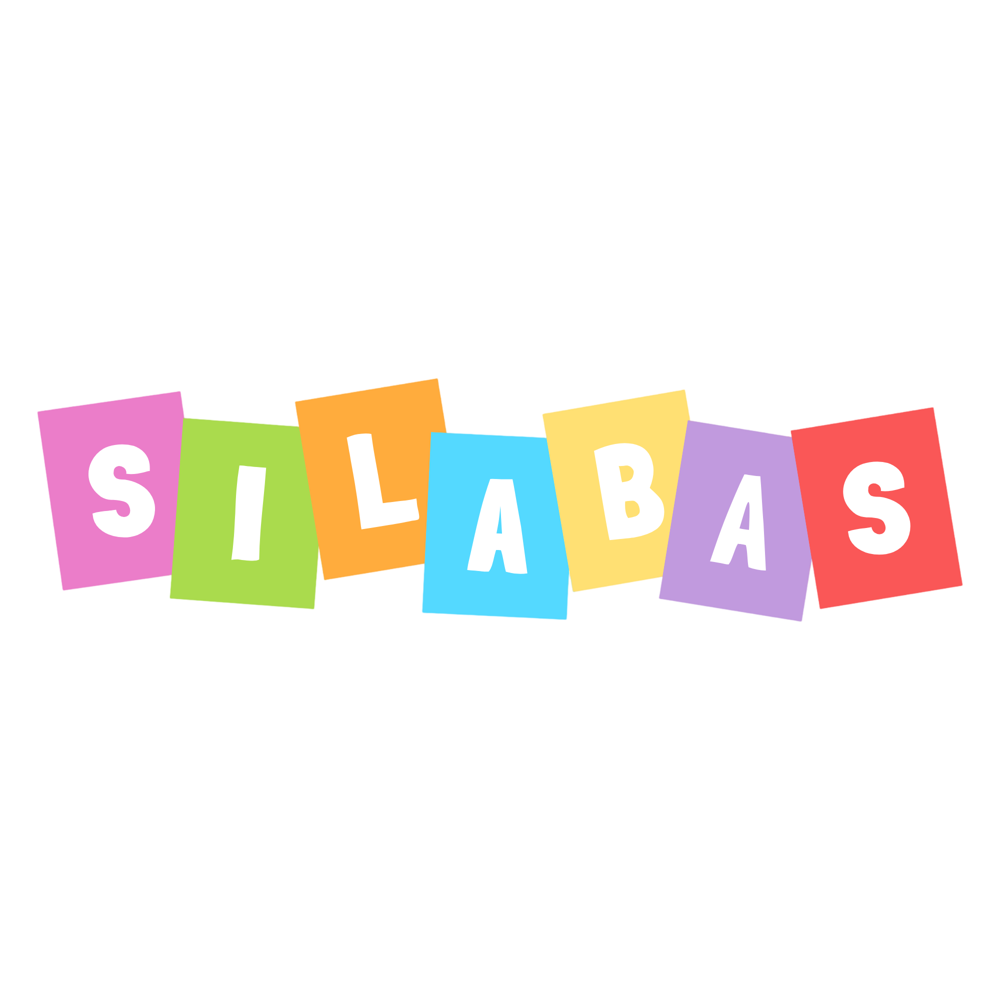
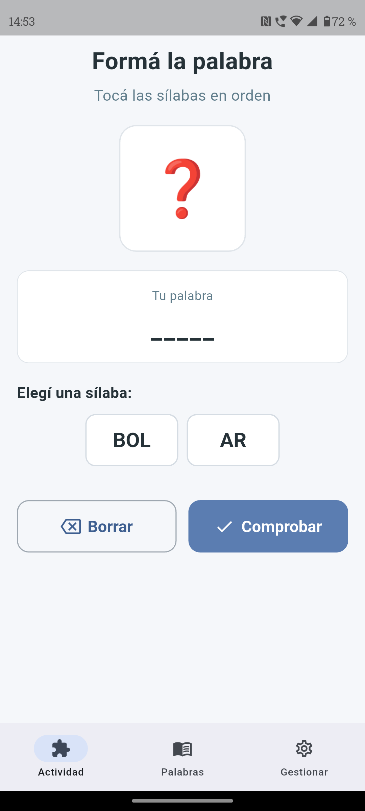
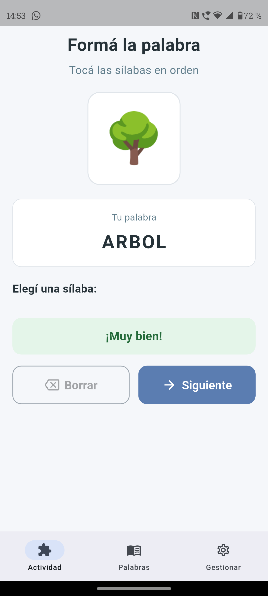
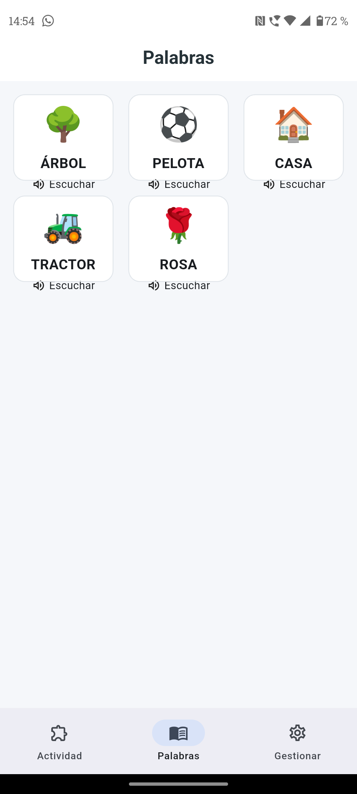
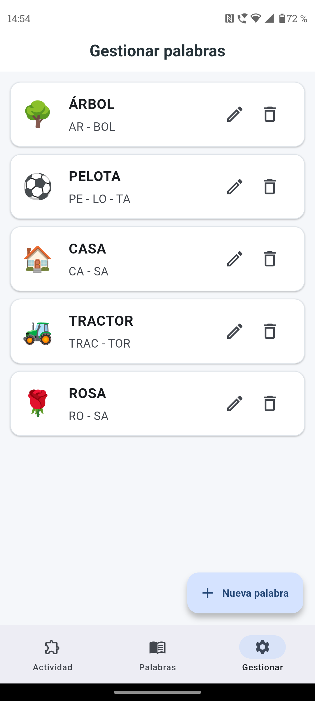
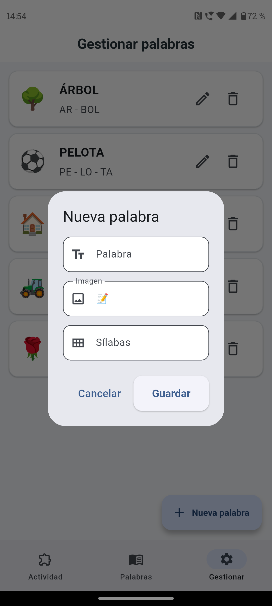

# 
Informe de la APP

  

## Proposito/Objetivo.
El software "Silabas" es una aplicación móvil desarrollada para facilitar y enriquecer el aprendizaje, para aquellos niños con alguna dificultad especial, asi de una forma podemos ayudar a profecionales a poder enseñar de una manera mas practica y que los mismos niños tengan iniciativa y ganas de aprender. A través de un enfoque multisensorial (interacción táctil, apoyo visual y retroalimentación auditiva inmediata) la aplicación convierte la conciencia fonológica y la estructuración de sílabas en una experiencia lúdica, accesible y predecible.  
Nustra app esepera poder impulsar en los niños  la lectura, escritura y de una forma tambien estimular la parte **auditiva** y **verbal**.  
Consideramos poder haber alcanzado las espectativas deseadas y buscadas por los directivos de la escuela San José Patriarca, ya que aplicamos todos los requisitos y necesidades  solicitadas que pudimos recaudar por medio de las entrevistas y reuniones con los profesionales.

## Usuarios finales de la APP.
### Destinatarios Principales:
  Niños con Trastorno del Espectro Autista (TEA), dificultades en el lenguaje o en proceso de alfabetización inicial. Ya que ellos requieren estímulos visuales claros (emojis/imágenes), secuencias predecibles, tambien conocido como pictrogramas.

### Destinatarios Secundarios:
  Educadores especiales, fonoaudiólogos, psicopedagogos y padres/tutores. 
  Cuentan con un panel de gestión que les permite adaptar el contenido didáctico a la evolución comunicativa y al contexto cotidiano del niño o niña.

## Desarrolladores.
- Figueroa Romero José Ignacio.
- Ferreyra Marcos.
- Rojas Agustina.
## Uso.
La aplicacion se compone de tres modulos principales principales accesibles desde la barra de navegación inferior:

**1. Sección "Actividad"** (Juego principal):
   - El usuario observa las sílabas desordenadas en pantalla.
   - Al presionar cada sílaba, el motor TTS reproduce su sonido exacto de forma fluida.
   - Al completar la palabra de forma correcta, la imagen/emoji oculto se revela, se reproduce la palabra entera y se otorgan puntos. 
  
  |  | |
| :---: | :---: |
|  |  |

**2. Sección "Palabras""** (Tarjetas de lectura):
   - Catálogo interactivo de palabras en formato grid.
  
   - Al tocar cualquier tarjeta, la voz sintetizada pronuncia la palabra correspondiente para ejercitar la lectura autónoma.

  

**3. Sección "Gestionar"** (Administración de contenido):
  - Módulo para añadir nuevas palabras, definir la segmentación silábica y asociar un emoji representativo.
  - Permite editar o eliminar palabras existentes para personalizar el progreso pedagógico. 
  
  |  | |
| :---: | :---: |
|  |  |